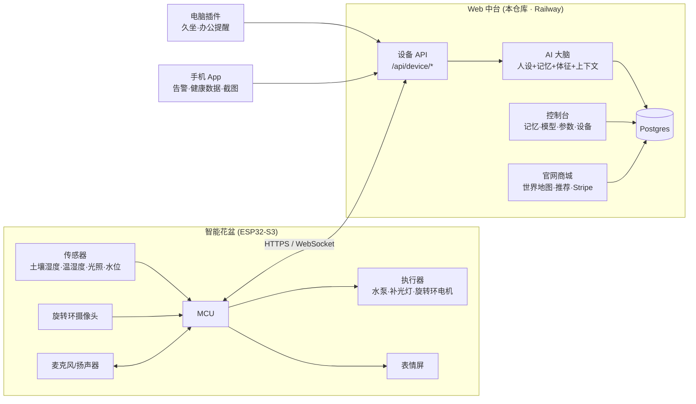

# oeeoee 全局规划：有生命体征的桌面 AI 伙伴

> 工作代号沿用仓库名 **oeeoee**（像一张有眼睛的小脸）。品牌名定下来后，改 `src/components/site/Logo.tsx` 和 i18n 文案即可。

## 1. 一句话定位

**一盆真的活着的植物 + 一个住在花盆里的 AI 角色。**
植物负责"生命感"，传感器把它的状态变成"身体体征"；AI 角色通过屏幕表情和语音，把植物的状态和你的健康、工作、生活连在一起。它放在你的书桌上，陪着你。

和现有产品的区别：

| 类别 | 代表 | 缺什么 |
|---|---|---|
| 智能花盆 | Click & Grow、LeGrow 等 | 只管养植物，没有"角色"，也没有陪伴 |
| 桌面 AI 机器人 | 小智类 ESP32 语音机器人、各种桌宠 | 有角色，但没有真正的生命体，用户新鲜感掉得快 |
| **oeeoee** | — | **植物的真实状态决定角色的情绪**：它渴了会说，它长新叶会开心。这种"真的在活着"的感觉是留存的核心 |

---

## 2. 产品全景

### 2.1 花盆：AI 智能养护（"身体"）

| 模块 | 建议方案 | 对应"体征" |
|---|---|---|
| 主控 | ESP32-S3（Wi-Fi + BLE，带 PSRAM，可驱屏、跑摄像头和语音） | — |
| 土壤湿度 | 电容式探针（不腐蚀） | 口渴 / 积水 |
| 温湿度 | SHT40 | 冷 / 热 / 空气干燥 |
| 光照 | VEML7700 / BH1750 | 晒太阳了吗 |
| 水箱水位 | 电容式液位或浮子 | 水箱快空了（推送提醒） |
| 浇水 | 5V 隔膜/蠕动泵 + 底部储水 | — |
| 补光 | 全光谱 LED，装在旋转环上，PWM 调光 | — |
| 温度 | 第一版只做监测+提醒（主动加热/制冷功耗和安全成本高，放到后续型号） | — |
| 旋转环 | 小型步进电机带动环形框架，**±170° 往复转动**，免滑环，降成本、提高可靠性 | — |
| 摄像头 | 环上 OV5640，定时多角度拍照 → 云端生长时间轴、病虫害识别 | 长新叶 / 叶子发黄 |
| 屏幕 | 1.8–3.5 寸彩屏（S/M/L 三档），显示表情 | — |
| 语音 | 双麦 + I2S 功放；唤醒词在本地，识别/合成在云端 | — |

**养护闭环要"离线优先"**：浇水、补光等基础规则在设备本地跑（断网植物也不能死），云端负责下发每种植物的养护目标（`/api/device/config`）并做更聪明的决策。本仓库已实现这个控制器的服务端版本（`src/lib/vitals.ts` 的 `careActions`）。

> 固件可以考虑基于开源的 xiaozhi-esp32 项目二次开发（语音链路、表情显示都有现成实现，使用前请确认许可证条款），把精力放在养护和角色上。

### 2.2 花盆：AI 陪伴（"性格"）

- **表情**：10 种表情（开心、兴奋、好奇、专注、困、口渴、担心、难过、爱心、平静），由**植物体征 + 对话情绪**共同决定。
- **性格**：每种植物自带人设（绿萝随和话痨、虎尾兰沉稳守护……），用户可以在中台改名字、补充人设。
- **提醒**：久坐、喝水、工作时段、免打扰时段；数据来自电脑插件和手机。
- **大脑在云端**：设备只做"耳朵、嘴巴和脸"，对话请求发到中台，中台拼上人设、记忆、植物状态和用户上下文后调用大模型。

### 2.3 Web 中台

1. **底层配置**（本仓库已实现 MVP）：账号（谷歌登录）、AI 角色设置（名字、人设、语言、音色、模型、温度、最大回复长度、提醒规则）、记忆管理（事实 / 偏好 / 事件 / 健康 / 工作，可手动增删，对话中自动学习）、设备管理（绑定、Token、体征曲线）、订单、对话测试台。
2. **电脑插件**（下一阶段）：建议用 Tauri 做托盘应用（体积小，跨 Mac/Windows）。
   - 只在本地判断"当前在做什么类别的事"（写代码 / 开会 / 文档 / 娱乐），**只上传类别和时长**，不上传截图和窗口内容。
   - 键鼠空闲检测 → 久坐时长 → 花盆提醒"站起来伸个懒腰吧"。
   - 可接日历 → 会议前提醒、专注时段花盆进入"专注脸"。

### 2.4 手机 App（下一阶段）

- Expo / React Native 一套代码出 iOS + Android。
- 花盆状态、体征曲线、生长相册（旋转环拍的照片）。
- **推送告警**：水箱没水、土壤过干/过湿、温度异常、设备离线。
- 健康数据：iOS HealthKit / Android Health Connect（步数、睡眠、心率）→ 角色关心你："昨晚只睡了 5 小时，今天少喝点咖啡？"
- 截图：用户主动通过系统分享把截图发给 App（不偷偷读相册），用视觉模型提炼待办和提醒。

---

## 3. 用户旅程

1. **官网**：世界地图 → 选大区 → 地图推进放大 → 选国家 → 花盆页（切换尺寸、颜色、植物，问卷推荐）→ 下单（Stripe）。
2. **开箱**：扫码 → App 蓝牙配网 → 设备自动绑定账号 → 花盆第一次睁眼打招呼。
3. **日常**：植物状态驱动表情；语音聊天；电脑久坐 / 手机睡眠数据触发提醒；水箱快空了手机推送。
4. **长期**：生长相册、记忆越来越懂你、换季推荐换盆/换植物（复购）。

---

## 4. 业务侧

### 4.1 市场策略（与网站逻辑一致）

| 模式 | 市场 | 卖什么 | 植物从哪来 |
|---|---|---|---|
| `full` | 中国大陆 | 花盆 + 活体植物 | 自己的国内供应链 |
| `pot_only` | 美国、日本、韩国、新加坡、澳洲、加拿大、英国、欧元区主要国家 | 只卖花盆，页面展示"在你所在地适合养的植物" | 用户在本地买；同时**招募当地植物合作商** |
| `coming_soon` | 其他国家 | 先收集候补名单（waitlist） | — |

为什么海外先只卖花盆：活体植物跨境需要植物检疫证书，很多国家禁止带土植物入境，运输损耗也高。**本地合作商**是唯一可规模化的方式。

### 4.2 植物合作商模式

- 阶段 A（招募期）：官网 `/partners` 收集申请，后台 `/admin` 跟进。用户在当地自行购买植物，花盆照样可用。
- 阶段 B（转介期）：国家页里展示合作商的植物和价格，导流下单，收 10–15% 佣金。
- 阶段 C（平台期）：Stripe Connect 一单结算、自动分账给合作商；合作商后台管理库存、标准尺寸（S/M/L）、本地配送。

### 4.3 收入结构（建议）

1. **硬件毛利**：粗估 M 款 BOM 约 ¥300–350（主控、屏、摄像头、传感器、泵、灯环、电机、陶瓷/外壳、组装、包装），零售 ¥999，留足渠道和售后空间。*以上为估算，需要打样后核实。*
2. **订阅（可选 Pro）**：更强的模型、长期记忆、生长相册云存储、健康洞察。基础陪伴免费，保证体验不打折。
3. **植物与耗材复购**：换植物、营养液、季节限定植物。
4. **合作商佣金**：海外市场的植物交易抽成。

### 4.4 核心指标

激活率（7 天内绑定设备）· 植物 90 天存活率 · 每日对话次数 / D30 留存 · 告警响应率 · 订阅转化 · NPS · CAC / LTV。

---

## 5. 关键风险与合规（务必提前处理）

| 风险 | 影响 | 建议 |
|---|---|---|
| **谷歌登录在中国大陆不可用** | 国内用户无法登录 | 国内版增加微信登录 / 手机号验证码。当前代码基于 Better Auth，可直接加 provider |
| **Stripe 不支持中国大陆主体** | 无法开户收款 | 用香港 / 新加坡 / 美国主体开 Stripe，国内用户通过 Stripe 的支付宝、微信支付付款；长期国内直连微信支付/支付宝商户 |
| **服务器在境外** | 国内访问慢；境内服务器需要 ICP 备案 | 海外版用 Railway；国内版单独部署到阿里云/腾讯云，完成 ICP 备案 |
| **大模型合规** | Anthropic Claude 不在中国大陆提供服务；国内提供生成式 AI 服务需要备案 | 中台已把模型做成每个角色可配置；国内版接入已备案的国产模型（通义、DeepSeek、豆包等），海外版用 Claude |
| **地图合规（审图号）** | 在中国公开展示的地图需符合国家标准、领土表示须完整准确 | 首页用"点阵地图"，不画国界线；中国高亮分组集中在一个配置常量里（`MARKET_FEATURE_GROUPS`），上线前请法务审核；国内版建议使用带审图号的底图 |
| **隐私：电脑插件、截图、健康数据** | 国内《个人信息保护法》、欧盟 GDPR、苹果/谷歌健康数据政策 | 本地处理、只传类别和统计值、逐项明示同意、可一键删除；健康数据不得用于广告 |
| **硬件认证** | 不认证不能上架 | 中国 CCC + SRRC，美国 FCC，欧盟 CE/RoHS，日本 TELEC/PSE；水电一体结构注意防水等级（IP） |
| **活体植物物流** | 损耗、检疫 | 国内与产地苗圃合作，标准化盆苗；海外完全本地化 |

---

## 6. 路线图

| 阶段 | 时间（相对） | 目标 | 产出 |
|---|---|---|---|
| **M0 网站 MVP** | 现在 | 官网 + 账号 + 中台雏形上线，开始收集预约和合作商 | 本仓库（见第 7 节） |
| M1 原型 | 1–4 月 | 10 台功能样机，固件跑通传感器→设备 API→表情→语音 | 固件、硬件 EVT、设备协议定稿 |
| M2 小批量 | 4–7 月 | 100–500 台内测 / 国内众筹 | App 和电脑插件 beta、DVT/PVT |
| M3 国内上市 | 7–12 月 | 中国大陆正式开卖 | 微信登录、国内部署 + ICP、生成式 AI 备案、CCC |
| M4 海外 | 9–15 月 | 美日欧开卖花盆（可先走 Kickstarter），首批植物合作商 | FCC/CE/TELEC、合作商转介 |
| M5 平台化 | 之后 | 合作商平台、Stripe Connect 分账、植物识别与生长相册 | 合作商后台、视觉模型 |

团队分工建议：硬件/结构（你或朋友 1 人 + 外包工厂）、嵌入式固件 1 人、全栈（本仓库 + App + 插件）1–2 人、供应链与合作商拓展 1 人。

---

## 7. 本仓库已实现（M0）

| 模块 | 路径 | 说明 |
|---|---|---|
| 首页世界地图 | `/` | 点阵世界地图，按大区→国家逐级推进放大；根据 IP / 时区 / 定位高亮用户所在地；产品介绍 |
| 国家花盆页 | `/c/[country]` | 切换尺寸（S/M/L）、颜色、植物（植物直接画在花盆里）；按摆放位置/光照/宠物/经验推荐植物；按国家显示销售模式 |
| 购物车 + 支付 | 购物车抽屉、`/api/checkout`、`/api/stripe/webhook` | 服务端重新计价，Stripe Checkout，Webhook 回写订单 |
| 候补名单 | `/api/waitlist` | 未开放国家收集邮箱 |
| 合作商招募 | `/partners` | 招募页 + 申请表 |
| 管理后台 | `/admin` | 订单状态流转、合作商申请、候补名单导出（`ADMIN_EMAILS` 控制权限） |
| 控制台（中台） | `/console` | 体征总览、AI 角色设置、记忆、设备与 Token、订单、对话测试台；一键生成"演示花盆"数据 |
| 设备 API | `/api/device/telemetry` · `/config` · `/chat` | 设备上报体征并拿到养护动作；拉取配置；语音对话 |
| AI 大脑 | `src/lib/companion/*` | 人设 + 植物性格 + 体征 + 记忆 + 历史 → 大模型 → 回复 + 表情 + 自动记忆 |
| 多语言 | 中 / 英 / 日 | `src/i18n` |

技术栈：Next.js 16 · Prisma 7 + PostgreSQL · Better Auth（谷歌登录）· Stripe · Claude API · Tailwind v4 · 部署 Railway（域名 oeeoee.com 的 DNS 在 Cloudflare）。
部署步骤见 [`DEPLOY.md`](DEPLOY.md)，任务拆分见 [`TASKS.md`](TASKS.md)，固件对接见 [`DEVICE_API.md`](DEVICE_API.md)。

### 验证情况

- 已验证：类型检查、代码规范、261 个单元测试、生产构建；在全新数据库上从头执行全部迁移后，用浏览器走完整条流程（地图选区→国家→花盆页、合作商页、登录、控制台+演示花盆+对话、管理后台、手机宽度中文版、手机菜单、404 页），无服务器报错；设备接口用 curl 走通上报→浇水指令→重复上报不重复浇水→配置→错误 Token。
- 全面排查过一轮 bug（商城支付、控制台/设备/AI 大脑、账号/管理后台/合作商、首页/地图/插画），修复包括：登录跳转漏洞、生产环境误开开发者登录、限流可被伪造 IP 绕过、浇水安全（水位未知不浇、按剩余水量和每日上限限量、重复上报不重复浇水）、补光避开免打扰时段、设置被悄悄改回、结账成功页误清空购物车、旧 Stripe 账号丢收货地址、品牌化 404/出错页等。
- 需要真实密钥后再验一次：**谷歌登录**（本地用开发者邮箱登录代替）、**Stripe 真实支付**（已用签名的模拟 Webhook 验证订单状态流转）、**Claude 真实对话**（本地走规则兜底回复；请求格式有单元测试覆盖）。
- 上线后确认：限流按 `X-Real-IP` 识别访客，这是 Railway 代理的行为，需在线上确认；如果在 Cloudflare 打开代理（橙色云朵），限流会变成按 Cloudflare 节点计算。
- 已知限制：表单/设备/对话的限流存在单进程内存里，Railway 扩到多实例前需换 Redis；合作商申请没有邮件通知；用户的订单只按账号关联；香港的真实位置在地图上会被识别为中国大陆（地图数据分不开港深），和港澳高亮分组一起待定。
- 说明：当前 Claude API 版本不再接受 `temperature` 参数，控制台里的"活泼度"滑块改为通过提示词调节语气。
